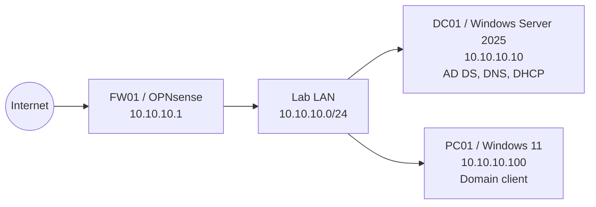
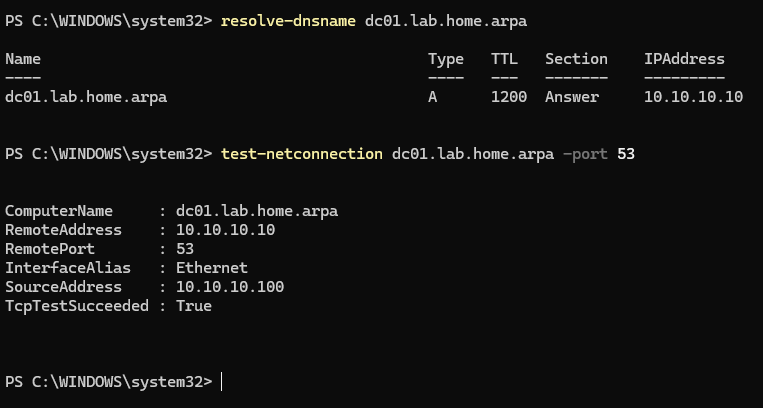
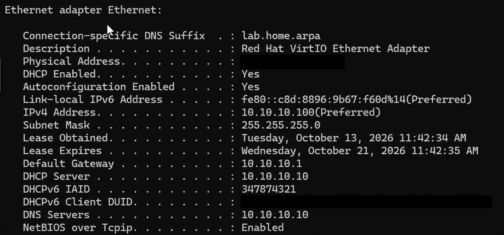
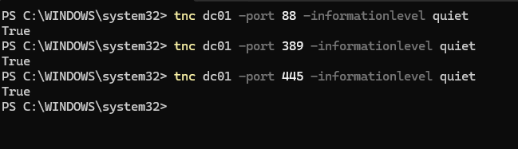
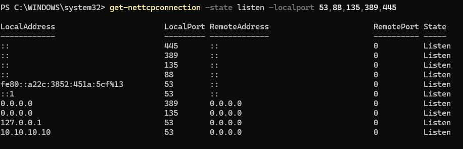
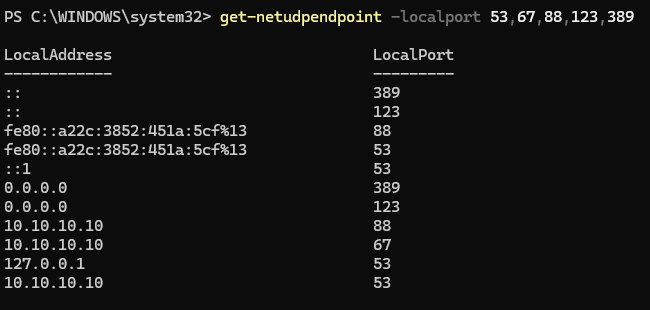
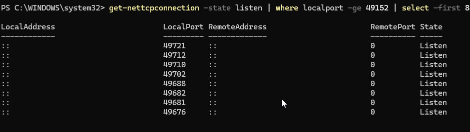
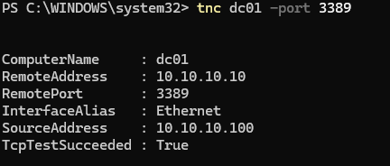
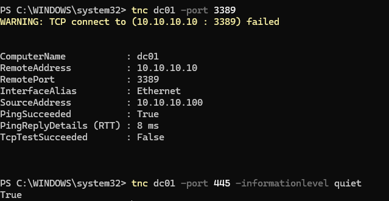
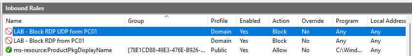

# Windows Domain Service Mapping and Firewall Validation

## Overview

This lab maps the network services used by a small Windows domain running on Proxmox. It validates DNS, DHCP, Kerberos, LDAP, SMB, NTP, RPC, and RDP, then applies a scoped Windows Defender Firewall policy and verifies the result with positive and negative connectivity tests.

The environment uses a single lab subnet. Because PC01 and DC01 communicate directly within that subnet, their traffic does not pass through OPNsense. The RDP restriction was therefore implemented on the Windows Defender Firewall of DC01.

## Objectives

- Identify the fixed TCP and UDP ports used by Windows domain services.
- Verify DNS resolution and DHCP client configuration.
- Confirm that required domain services are reachable from PC01.
- Inspect listening TCP ports and UDP endpoints on DC01.
- Observe the relationship between TCP 135 and dynamic RPC ports.
- Apply a least-privilege firewall rule to block RDP from one client.
- Perform before-and-after validation without disrupting required SMB access.

## Lab environment

| System | Platform and role | Address |
|---|---|---|
| Proxmox | Virtualization host | Management network not documented publicly |
| FW01 | OPNsense gateway and firewall | `10.10.10.1` |
| DC01 | Windows Server 2025, AD DS, DNS and DHCP | `10.10.10.10` |
| PC01 | Windows 11 domain client | `10.10.10.100` |
| Domain | Active Directory DNS namespace | `lab.home.arpa` |
| Lab network | IPv4 subnet | `10.10.10.0/24` |

## Topology



## Traffic and service matrix

| Source | Destination | Transport and port | Service | Policy | Observed result |
|---|---|---|---|---|---|
| PC01 | DC01 | UDP/TCP 53 | DNS | Allow | Name resolution succeeded; TCP 53 was reachable |
| PC01 | DC01 | UDP 67/68 | DHCP | Allow | PC01 received its address and network options from DC01 |
| PC01 | DC01 | TCP 88 | Kerberos | Allow | TCP connectivity succeeded |
| PC01 | DC01 | TCP 389 | LDAP | Allow | TCP connectivity succeeded |
| PC01 | DC01 | TCP 445 | SMB | Allow | TCP connectivity succeeded before and after the firewall change |
| PC01 | DC01 | TCP/UDP 3389 | RDP | Block | TCP succeeded before the rule and failed after it; both TCP and UDP block rules were enabled |
| DC01 | Local service | UDP 123 | NTP | Required | An NTP endpoint was present on the server |
| Domain systems | DC01 | TCP 135 and dynamic high TCP ports | Microsoft RPC | Required | Endpoint Mapper and high-numbered listening ports were observed |

## Procedure and evidence

### 1. DNS service validation

The client resolved the domain controller name and tested TCP connectivity to DNS port 53.

```powershell
Resolve-DnsName dc01.lab.home.arpa
Test-NetConnection dc01.lab.home.arpa -Port 53
```



### 2. DHCP client configuration

`ipconfig /all` confirmed that PC01 obtained its IPv4 configuration through DHCP. DC01 supplied the DHCP and DNS services, while FW01 was the default gateway.

```powershell
ipconfig /all
```



### 3. Required domain service ports

TCP connectivity from PC01 to the Kerberos, LDAP, and SMB ports on DC01 was tested independently.

```powershell
Test-NetConnection dc01 -Port 88 -InformationLevel Quiet
Test-NetConnection dc01 -Port 389 -InformationLevel Quiet
Test-NetConnection dc01 -Port 445 -InformationLevel Quiet
```



### 4. TCP listeners on DC01

The server-side check confirmed that the selected fixed TCP ports were in the `Listen` state.

```powershell
Get-NetTCPConnection -State Listen -LocalPort 53,88,135,389,445
```



### 5. UDP endpoints on DC01

The UDP inventory showed endpoints for DNS, DHCP, Kerberos, NTP, and CLDAP-related communication.

```powershell
Get-NetUDPEndpoint -LocalPort 53,67,88,123,389
```



### 6. Dynamic RPC ports

TCP 135 is the fixed RPC Endpoint Mapper port. After the initial mapping, Windows services can use dynamically allocated high TCP ports. The following command displayed a sample of listeners from the modern Windows dynamic range.

```powershell
Get-NetTCPConnection -State Listen |
    Where-Object LocalPort -ge 49152 |
    Select-Object -First 8
```



The output demonstrates high-numbered listeners, but a port number alone does not prove that every displayed listener belongs to RPC. Process and service correlation would be required for exact attribution.

### 7. RDP test before the firewall change

Before applying the restriction, TCP 3389 on DC01 was reachable from PC01.

```powershell
Test-NetConnection dc01 -Port 3389
```



### 8. Scoped firewall control

Two inbound Windows Defender Firewall rules were created on DC01:

| Rule | Protocol | Local port | Remote source | Profile | Action |
|---|---|---:|---|---|---|
| `LAB - Block RDP from PC01` | TCP | 3389 | `10.10.10.100` | Domain | Block |
| `LAB - Block RDP UDP from PC01` | UDP | 3389 | `10.10.10.100` | Domain | Block |

The rules are deliberately limited to PC01 instead of disabling RDP globally.

### 9. Positive and negative validation

After enabling the rules, TCP 3389 failed from PC01 while TCP 445 remained reachable. Ping also succeeded, proving that DC01 was still online and that only the intended service flow was restricted.

```powershell
Test-NetConnection dc01 -Port 3389
Test-NetConnection dc01 -Port 445 -InformationLevel Quiet
```



### 10. Firewall rule verification

The inbound rule list confirmed that both scoped rules were enabled for the Domain profile with the `Block` action.



## Key findings

- DNS and DHCP are foundational services in the domain. PC01 used DC01 for both name resolution and address configuration.
- Kerberos, LDAP, SMB, RPC, and DNS must remain reachable for normal Active Directory operation.
- Fixed ports identify well-known service entry points, while RPC can negotiate additional dynamic high ports.
- A successful `Test-NetConnection` result confirms TCP reachability only. It does not prove successful authentication, authorization, or correct application-layer behavior.
- A failed TCP test is meaningful here because the same source and destination succeeded before the firewall change and failed immediately after the scoped block rule was enabled.
- The successful SMB retest demonstrates that the firewall change did not unnecessarily interrupt another required domain service.

## Limitations and future improvements

- `Test-NetConnection` validates TCP, so the UDP 3389 rule was configuration-verified but not functionally tested with this command.
- The current environment uses one subnet. Inter-segment policy testing would require an additional VLAN or subnet so that traffic is routed through OPNsense.
- A future extension could add a dedicated member server and an administrative workstation, allowing RDP only from the management segment while denying it from ordinary client systems.
- The PC01 firewall scope uses its current DHCP address. A DHCP reservation or a management subnet would make the policy more durable.

## Privacy note

Only private laboratory addresses are shown. Hardware identifiers and other unnecessary client-specific values were masked before publication.

## Conclusion

The lab successfully mapped essential Windows domain services, distinguished fixed service ports from dynamic RPC listeners, and demonstrated a controlled firewall change using before-and-after evidence. RDP access from PC01 was blocked while required SMB connectivity remained available, illustrating practical service validation and least-privilege network control.
