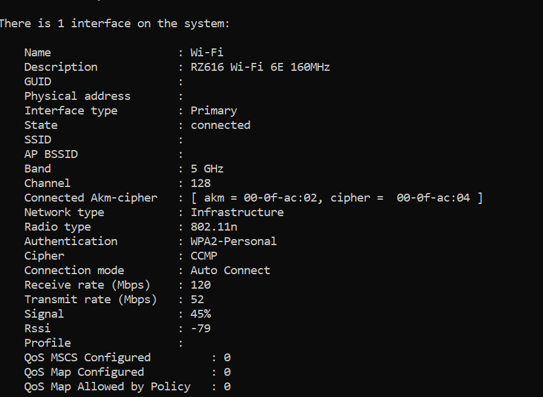
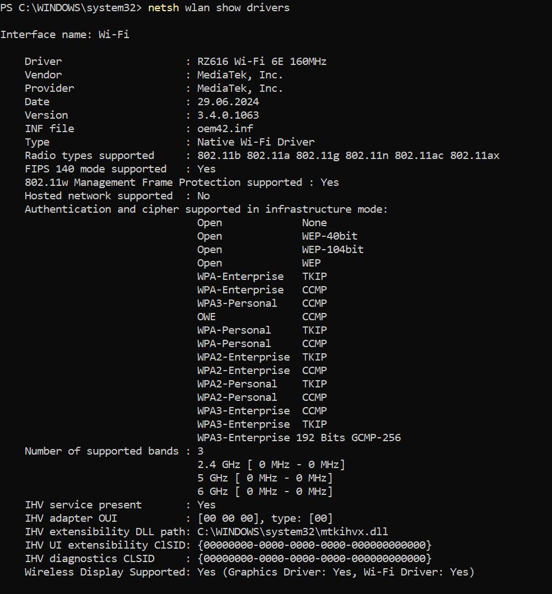
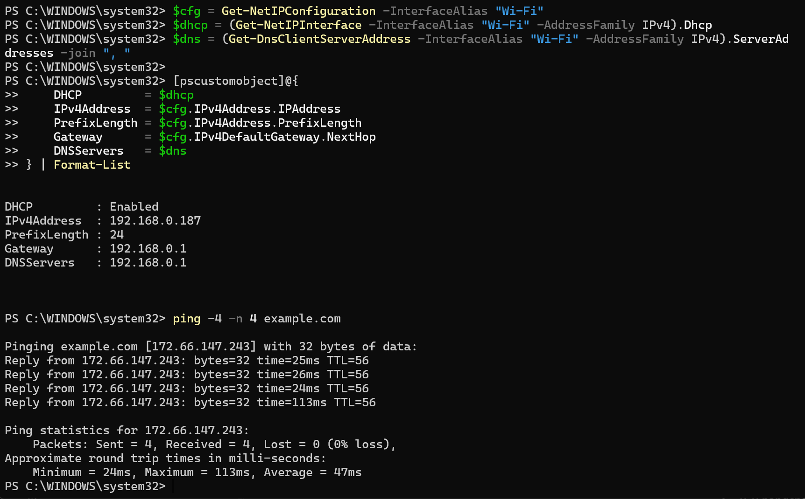
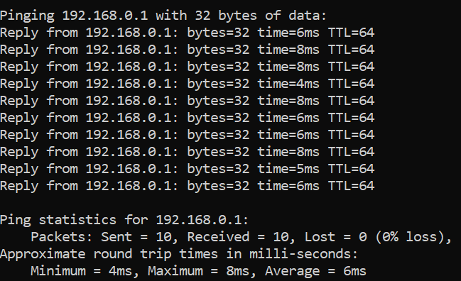
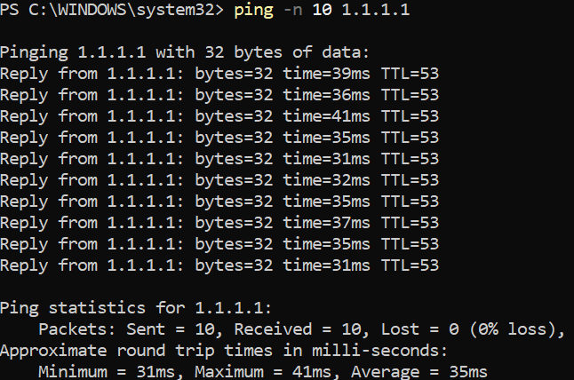
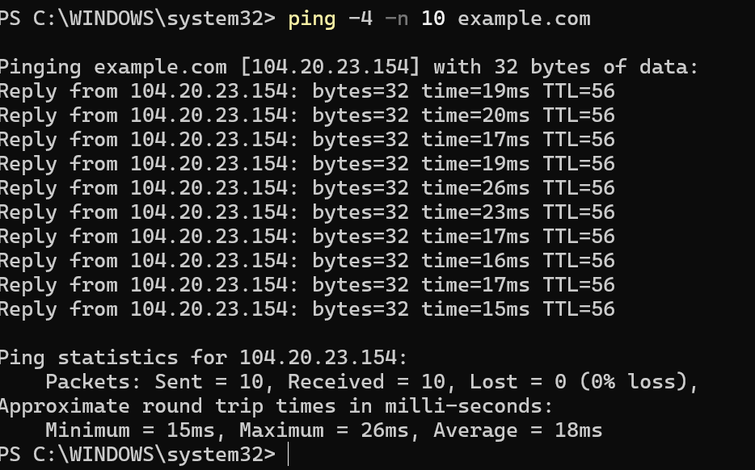
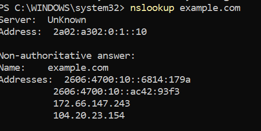

# Wireless Environment Analysis

## Objective

Inspect the active Wi-Fi connection and adapter capabilities, identify the client's addressing configuration, and verify gateway, Internet, and DNS connectivity.

## Environment

- Client: Windows 11
- Wireless adapter: RZ616 Wi-Fi 6E 160MHz
- Connection type: Wi-Fi
- Tools: Windows PowerShell, Command Prompt, and `netsh`

## Methodology

The following commands were used:

```powershell
Get-NetAdapter -Name "Wi-Fi"
netsh wlan show interfaces
netsh wlan show drivers
Get-NetIPConfiguration -InterfaceAlias "Wi-Fi"
ipconfig /all
ping -n 10 192.168.0.1
ping -n 10 1.1.1.1
nslookup example.com
ping -4 -n 10 example.com
```

## Findings

### Active Wi-Fi Connection

| Property | Observed value |
|---|---|
| Band | 5 GHz |
| Channel | 128 |
| Active radio type | 802.11n |
| Authentication | WPA2-Personal |
| Cipher | CCMP |
| Receive link rate | 120 Mbps |
| Transmit link rate | 52 Mbps |
| Signal | 45% |
| RSSI | -79 dBm |

The connection was operational, but the captured signal level was relatively weak.



### Adapter Capabilities

The adapter reported support for 802.11b/a/g/n/ac/ax, the 2.4, 5, and 6 GHz bands, WPA3, and 802.11w management-frame protection. The hardware therefore supported newer standards than the 802.11n mode used by the active connection at the time of the capture.



### Addressing, DHCP, and DNS

The Wi-Fi interface used a private IPv4 address in `192.168.0.0/24`. DHCP was enabled, and the local router at `192.168.0.1` acted as the default gateway and DNS resolver.



### Connectivity Tests

| Test | Packet loss | Minimum | Average | Maximum | Interpretation |
|---|---:|---:|---:|---:|---|
| Local gateway, 10 packets | 0% | 4 ms | 6 ms | 8 ms | Stable local connectivity during the sample |
| `1.1.1.1`, 10 packets | 0% | 31 ms | 35 ms | 41 ms | Internet routing worked independently of DNS |
| `example.com` over IPv4, 10 packets | 0% | 15 ms | 18 ms | 26 ms | Name resolution and IPv4 connectivity worked |

An earlier short sample to `example.com` contained a temporary 113 ms delay. The longer ten-packet run did not reproduce it, so it was treated as a transient observation rather than a persistent fault.







### DNS Resolution

`nslookup` returned both IPv4 and IPv6 records for `example.com`. `Server: Unknown` meant that the resolver address had no reverse-DNS name available; the forward lookup itself succeeded.



## Conclusion

The client had working DHCP configuration, local-gateway access, Internet reachability, and DNS resolution. No packet loss occurred in the recorded ten-packet tests. The adapter supported modern wireless standards and security features, but the active capture used 802.11n with a weak signal, which justified further channel and band testing in the next lab.

## Privacy

The SSID, BSSID/MAC addresses, adapter identifier, and other identifying values were masked before publication. Private addressing required to explain the local tests was retained.

