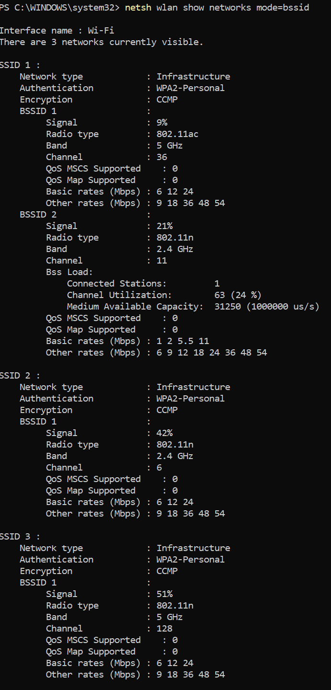
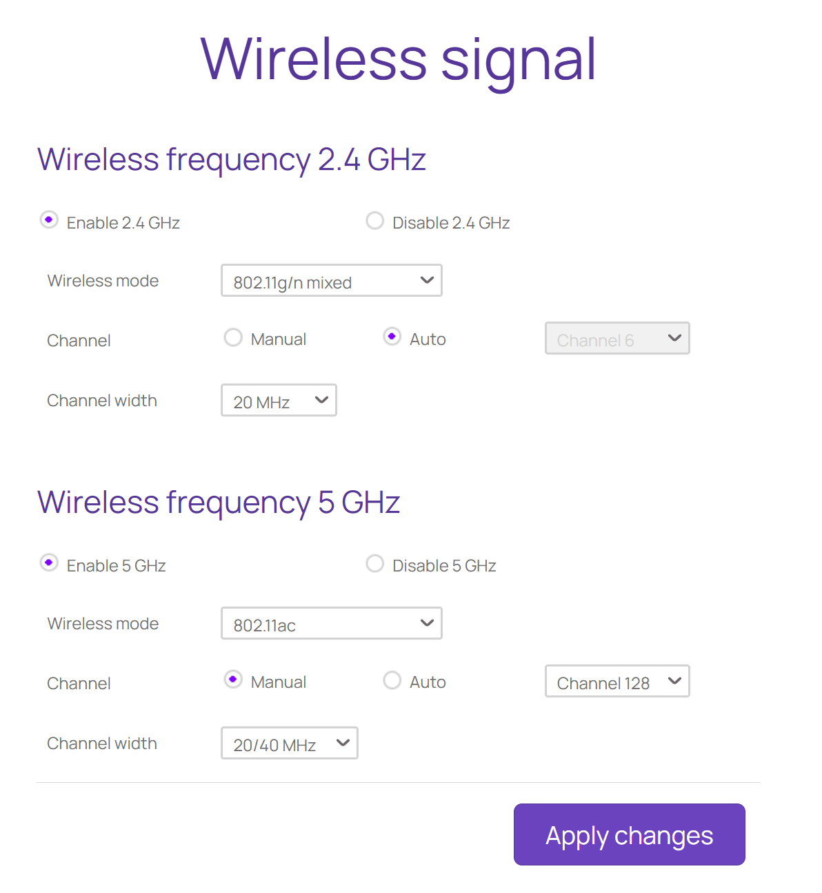
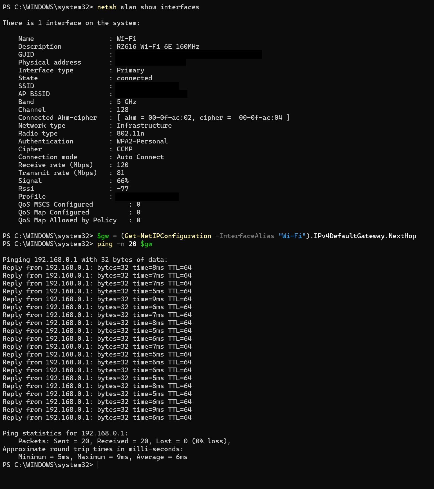
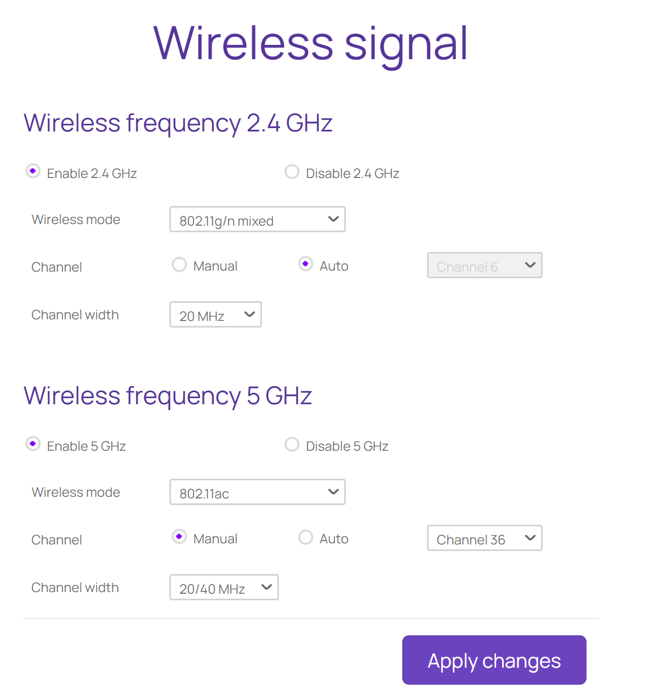
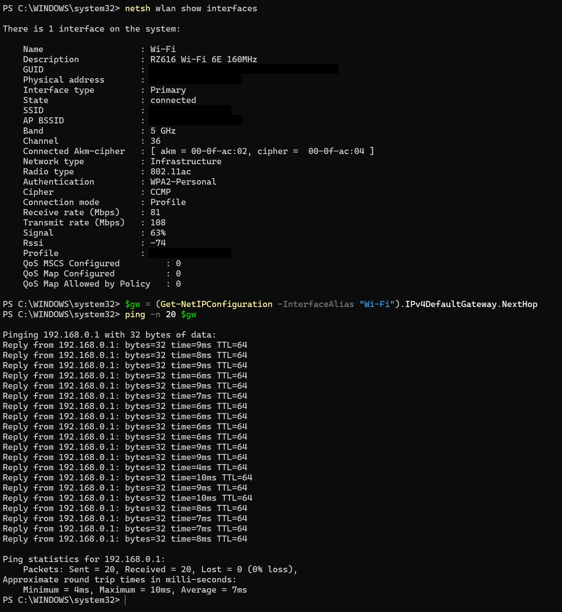
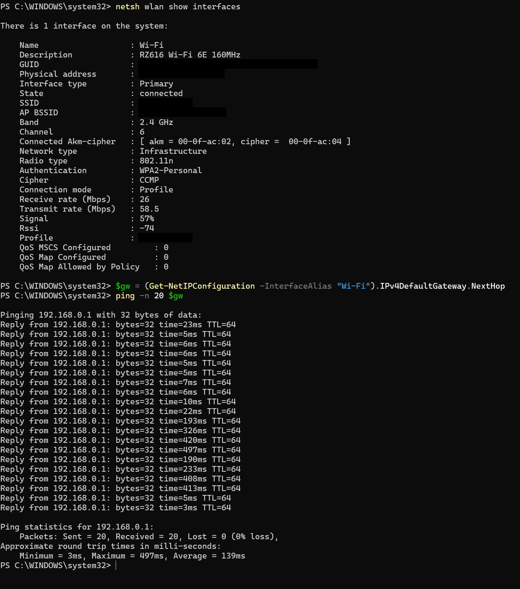
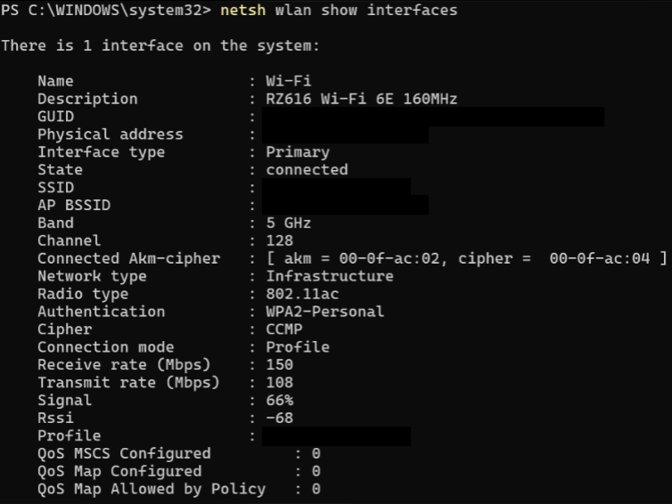
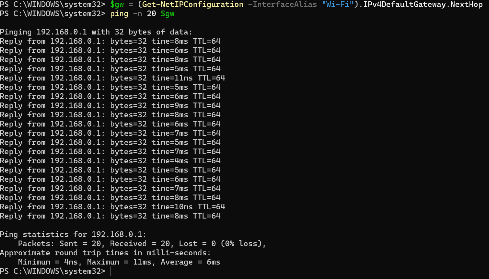

# Channel and Interference Analysis

## Objective

Survey nearby wireless networks, test whether changing the 5 GHz channel improves the connection, compare 2.4 GHz and 5 GHz performance, and document the result using repeatable measurements.

## Environment and Method

- Client: Windows 11
- Router: dual-band home wireless router
- Tools: `netsh`, `ping`, and Fast.com
- Scan command: `netsh wlan show networks mode=bssid`
- Connection command: `netsh wlan show interfaces`
- Latency command: `ping -n 20 192.168.0.1`

Only one router setting was intentionally changed at a time. Channel 36 was tested and then the original 5 GHz channel 128 was restored because the change did not improve the connection.

## Nearby Network Survey

| Anonymized network | Band | Channel | Signal | Radio type |
|---|---:|---:|---:|---|
| Network 1, access point 1 | 5 GHz | 36 | 9% | 802.11ac |
| Network 1, access point 2 | 2.4 GHz | 11 | 21% | 802.11n |
| Network 2 | 2.4 GHz | 6 | 42% | 802.11n |
| Network 3 | 5 GHz | 128 | 51% | 802.11n |

The snapshot showed 2.4 GHz use on channels 6 and 11 and 5 GHz use on channels 36 and 128. It did not show an obvious same-channel conflict, but a single scan cannot represent every time of day or hidden source of interference.

## Channel-Change Experiment

### Hypothesis

Changing the 5 GHz network from DFS channel 128 to non-DFS channel 36 might improve stability and latency.

### Baseline on Channel 128

| Metric | Result |
|---|---:|
| Radio type | 802.11n |
| Receive / transmit link rate | 120 / 81 Mbps |
| Signal / RSSI | 66% / -77 dBm |
| Gateway ping | 0% loss; 5 ms min, 6 ms avg, 9 ms max |

### Test on Channel 36

| Metric | Result |
|---|---:|
| Radio type | 802.11ac |
| Receive / transmit link rate | 81 / 108 Mbps |
| Signal / RSSI | 63% / -74 dBm |
| Gateway ping | 0% loss; 4 ms min, 7 ms avg, 10 ms max |

The average gateway latency increased from 6 to 7 ms, the receive link rate decreased from 120 to 81 Mbps, and the connection felt less reliable. The hypothesis was therefore **not supported**, and channel 128 was restored.

## 2.4 GHz Versus 5 GHz

| Metric | 2.4 GHz, channel 6 | Restored 5 GHz, channel 128 |
|---|---:|---:|
| Radio type | 802.11n | 802.11ac |
| Signal / RSSI | 57% / -74 dBm | 66% / -68 dBm |
| Receive / transmit link rate | 26 / 58.5 Mbps | 150 / 108 Mbps |
| Gateway ping loss | 0% | 0% |
| Gateway ping min / avg / max | 3 / 139 / 497 ms | 4 / 6 / 11 ms |
| Fast.com download result | 16 Mbps | 130 Mbps |

At this location, 5 GHz produced roughly **8.1 times** the measured Internet download rate and much lower latency variation than 2.4 GHz. This result applies to the tested location and time; Internet speed tests can also be affected by the ISP, selected test server, and background traffic.

The underlying results are also available as [CSV data](data/measurements.csv).

## DFS Observation

After channel 128 was restored, the 5 GHz network disappeared for several minutes and then returned. This behavior is consistent with a DFS channel-availability check, during which an access point may wait and listen for radar before transmitting. Because the router's internal logs were not captured, this remains a reasoned interpretation rather than a confirmed cause.

## Conclusion

The controlled channel change did not improve performance, so the original setting was restored. The later band comparison showed that 5 GHz channel 128 provided the best observed result: 130 Mbps download, 6 ms average gateway latency, and no packet loss. The experiment also demonstrated why link rate, signal level, latency, and application-level throughput should be evaluated together.

## Privacy

Network names, BSSIDs/MAC addresses, profile identifiers, and other identifying values were masked. Router credentials were never included in the evidence.

