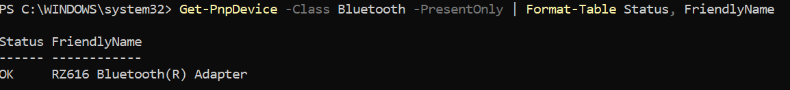
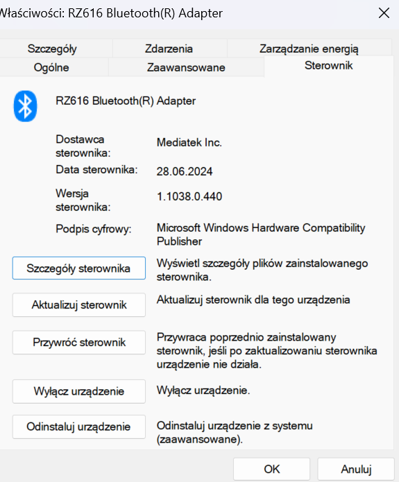

# Bluetooth and NFC Inventory

## Objective

Identify the Bluetooth adapter and driver, check whether Windows exposes an NFC/proximity device, and perform a basic Bluetooth range and stability test.

## Environment

- Client: Windows 11
- Bluetooth adapter: RZ616 Bluetooth Adapter
- Tools: Windows PowerShell and Device Manager

## Bluetooth Device Inventory

Command:

```powershell
Get-PnpDevice -Class Bluetooth -PresentOnly |
    Format-Table Status, FriendlyName
```

Windows detected the RZ616 Bluetooth Adapter and reported its Plug and Play status as `OK`.



## Driver Inspection

The adapter's driver details were inspected in Device Manager.

| Property | Observed value |
|---|---|
| Provider | MediaTek, Inc. |
| Date | 28 June 2024 |
| Version | 1.1038.0.440 |
| Digital signer | Microsoft Windows Hardware Compatibility Publisher |

The valid hardware-compatibility signature confirms the displayed driver package was signed for Windows. It does not by itself prove that the driver is the newest available version.



## NFC and Proximity Check

Command:

```powershell
$nfc = Get-PnpDevice | Where-Object {
    $_.Class -eq "Proximity" -or
    $_.FriendlyName -match "NFC|Near Field"
}
$nfc
```

The query returned no matching devices. Windows therefore did not expose NFC/proximity hardware to this test, so the optional practical NFC-tag exercise was not performed.


## Bluetooth Range Test

| Test position | Observation |
|---|---|
| Next to the PC | Stable |
| Approximately 5 metres away | Stable |
| Behind one wall | Occasional interruptions |

The test supports the conclusion that distance and physical obstacles can reduce connection stability. It was a qualitative observation rather than a controlled radio-frequency measurement; device battery level, interference in the 2.4 GHz band, and the building materials may also have affected the result.

## Conclusion

Windows detected a healthy Bluetooth adapter with a signed MediaTek driver. Bluetooth remained stable nearby and at approximately five metres, while occasional interruptions occurred behind one wall. No NFC/proximity device was detected, so no claim was made about practical NFC operation on this computer.

## Privacy

Only hardware and driver information relevant to the lab was retained. Device identifiers and unrelated system details were excluded from the published evidence.

