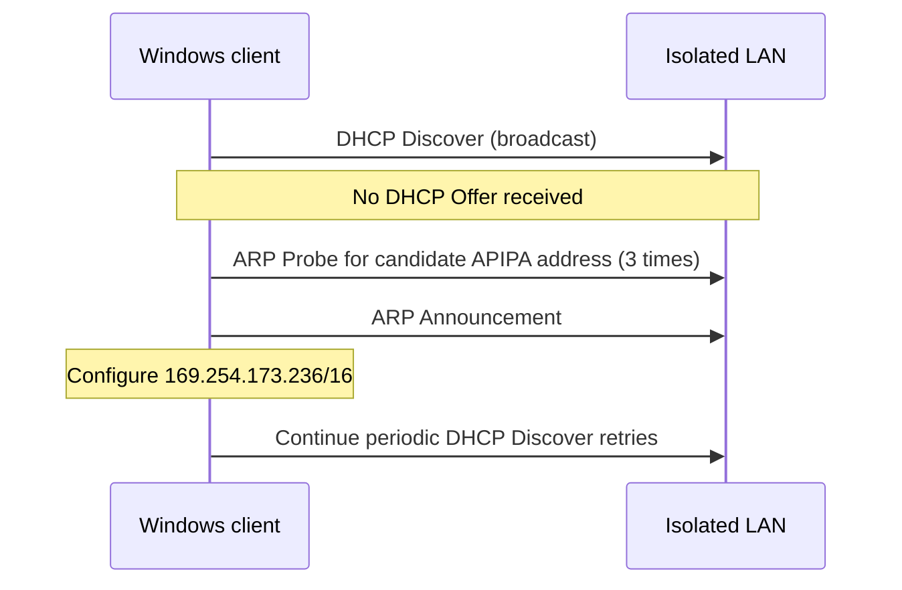

# DHCP Address Management and Analysis

## Objective

Validate a Windows DHCP server from the service, authorization, interface, and scope perspectives, capture a successful client lease renewal, and analyze the Windows APIPA fallback process when no DHCP server is reachable.

## Environment

| Component | Role | Address or name |
|---|---|---|
| Proxmox VE | Virtualization platform | Lab host |
| OPNsense (`FW01`) | Default gateway and firewall | `10.10.10.1` |
| Windows Server 2025 (`DC01`) | Active Directory domain controller and DHCP server | `10.10.10.10` |
| Windows 11 (`PC01`) | Domain client and packet-capture host | `10.10.10.100` |
| Active Directory domain | Internal namespace | `lab.home.arpa` |
| Lab network | Isolated client/server segment | `10.10.10.0/24` |
| Temporary isolated segment | DHCP-failure test network | No uplink, gateway, or DHCP service |

## Methodology

### 1. DHCP server baseline

The server was checked from several independent perspectives:

```powershell
Get-Service DHCPServer
Get-DhcpServerInDC
Get-DhcpServerv4Binding -ComputerName DC01
```

The DHCP Server service was running, `DC01` was authorized in Active Directory, and the IPv4 service was bound to the expected Ethernet interface at `10.10.10.10`.

### 2. Scope configuration and utilization

The active scope and its current statistics were inspected:

```powershell
Get-DhcpServerv4Scope -ComputerName DC01 | Format-Table ScopeId,State,StartRange,EndRange,LeaseDuration
Get-DhcpServerv4ScopeStatistics -ComputerName DC01
```

The `10.10.10.0/24` scope was active. Its pool covered `10.10.10.100` through `10.10.10.200`, with an eight-day lease duration. At the time of observation, one address was in use and 100 were free.

### 3. Successful client renewal

Wireshark captured the Ethernet interface on `PC01`. The following display filter isolated DHCP traffic:

```text
udp.port == 67 || udp.port == 68
```

While the capture was running, the client renewed its existing lease:

```powershell
ipconfig /renew "Ethernet"
```

The capture showed a DHCP Request from the client followed by a DHCP ACK from the server. Both packets used transaction ID `0xf52d40f9`, correlating them as one renewal exchange.

### 4. DHCP failure and APIPA fallback

A temporary second virtual NIC was attached to an isolated segment with no DHCP service. The primary domain-connected NIC remained unchanged. Wireshark used the following display filter on the test NIC:

```text
dhcp || arp
```

The capture showed this sequence:



Windows selected `169.254.173.236/16` only after probing for an address conflict. It continued sending DHCP Discover messages after configuring APIPA, allowing normal DHCP configuration to replace the fallback address if a server later becomes available.

The assigned address and routes were inspected with:

```powershell
Get-NetIPAddress -InterfaceIndex <test-interface> -AddressFamily IPv4 |
    Select-Object InterfaceAlias,IPAddress,PrefixLength,AddressState

Get-NetRoute -InterfaceIndex <test-interface> -AddressFamily IPv4 |
    Format-Table DestinationPrefix,NextHop,RouteMetric
```

The route table contained the on-link `169.254.0.0/16` network and host-specific entries, but no default route (`0.0.0.0/0`). This confirmed that APIPA provided local-link communication only, without routed network or Internet access.

## Evidence

| File | Evidence | Result |
|---|---|---|
| [DHCP scope configuration](screenshots/01-dhcp-scope-configuration.png) | Scope state, pool, and lease duration | Active `10.10.10.0/24` scope; pool `10.10.10.100–10.10.10.200`; eight-day lease |
| [DHCP scope statistics](screenshots/02-dhcp-scope-statistics.png) | Current address utilization | One address in use, 100 free, no reservations or pending offers |
| [DHCP renewal analysis](screenshots/03-dhcp-renewal-analysis.png) | Filtered Request/ACK exchange and decoded ACK | Client renewal succeeded and the server returned DHCP configuration options |
| [APIPA route table](screenshots/04-apipa-route-table.png) | Routes created on the isolated test interface | On-link `169.254.0.0/16` route present; no default route |

## Packet Analysis

### Successful DHCP renewal

| Field | Observed value | Interpretation |
|---|---|---|
| Transport protocol | UDP | DHCP uses connectionless transport |
| Client endpoint | `10.10.10.100:68` | `PC01` sent the renewal request |
| Server endpoint | `10.10.10.10:67` | `DC01` provided the DHCP service |
| Client message | DHCP Request | The client requested renewal of its existing lease |
| Server message | DHCP ACK | The server approved the lease and returned configuration options |
| Transaction ID | `0xf52d40f9` | The ACK matched the Request |
| Assigned client address | `10.10.10.100` | The existing client lease remained valid |
| Server Identifier | `10.10.10.10` | The response came from the expected DHCP server |
| Subnet mask | `255.255.255.0` | The client remained in the `10.10.10.0/24` network |
| ACK options | Lease timing, router, DNS server, and domain name | The server supplied the parameters required for normal client networking |

### APIPA fallback

| Stage | Observed traffic or state | Interpretation |
|---|---|---|
| DHCP discovery | `0.0.0.0` to `255.255.255.255` | The unconfigured client searched for a DHCP server |
| DHCP response | No Offer or ACK | The isolated segment contained no DHCP service |
| Conflict detection | Three ARP Probes for `169.254.173.236` | Windows verified that the candidate address was not already in use |
| Address claim | ARP Announcement for `169.254.173.236` | The client announced ownership of the selected address |
| Local route | `169.254.0.0/16` via `0.0.0.0` | The APIPA range was directly reachable on the test link |
| Default route | Not present | The interface could not reach routed networks or the Internet |
| Continued recovery | Repeated DHCP Discover messages | Windows kept searching for normal DHCP configuration |

## Findings

- The DHCP service was running, authorized in Active Directory, and bound to the correct server interface.
- The configured pool contained 101 addresses; one was leased and 100 remained available.
- DHCP used UDP port 68 on the client and UDP port 67 on the server.
- The matching transaction ID linked the DHCP ACK to the client's DHCP Request.
- Only Request and ACK appeared during renewal because the client already held a valid lease. A new client normally performs the full DORA sequence: Discover, Offer, Request, and Acknowledge.
- When no DHCP server responded, Windows selected an APIPA address from `169.254.0.0/16` after ARP-based duplicate-address detection.
- APIPA created no default gateway, so it supported communication only on the local link.
- DHCP retries continued after APIPA assignment, demonstrating that APIPA is a fallback state rather than a permanent replacement for DHCP.
- A successful ACK proves that this client renewed its lease from the expected server at that moment. It does not by itself prove DHCP availability on every VLAN or rule out the presence of another DHCP server elsewhere.

## Security and Privacy

- The work was performed in an isolated home-lab environment.
- No credentials, tokens, public IP addresses, personal domains, or production hostnames are published.
- Purpose-built lab names and private RFC 1918 addresses were retained because they are necessary to explain the exchange.
- The raw APIPA packet-capture screenshot was intentionally not published because it exposed NIC-derived identifiers and DHCP client metadata.
- The published route-table screenshot contains only a link-local address and generic interface data. The packet sequence is documented as a minimal diagram and table instead of exposing the raw capture.

## Conclusion

The lab connected server-side DHCP configuration with two client-side outcomes: a successful Request/ACK renewal and an unsuccessful discovery that triggered Windows APIPA fallback. Packet and route analysis confirmed duplicate-address detection, link-local `169.254.0.0/16` addressing, the absence of a default route, and continued DHCP recovery attempts.

[Back to portfolio](../../README.md)
