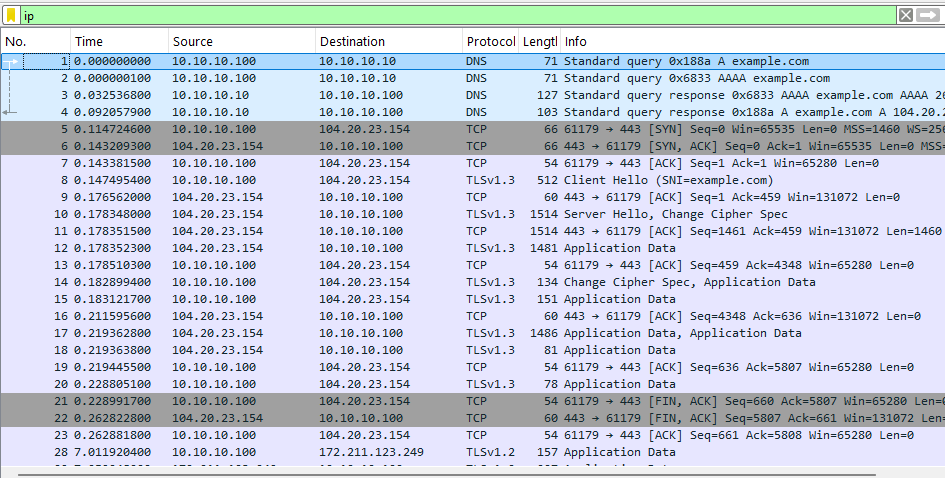
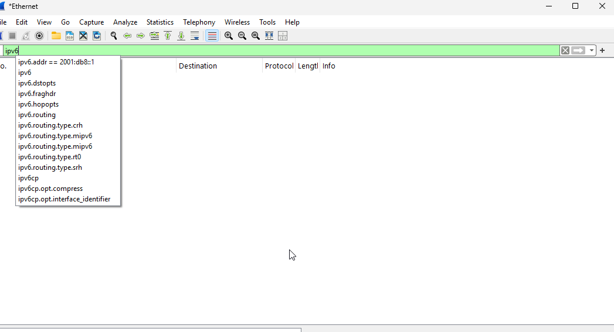

# IPv4, IPv6, Routing, and NAT Analysis

This module documents hands-on inspection of IPv4 and IPv6 addressing, local and default routes, source NAT across an OPNsense firewall, and protocol-level traffic analysis in Wireshark.

## Objectives

The exercises were designed to:

- inventory IPv4 and IPv6 configuration on Windows and Debian;
- interpret prefix lengths, gateways, DNS settings, and connected routes;
- distinguish an IPv6 link-local address from routed IPv6 connectivity;
- observe an HTTPS flow before and after OPNsense source NAT;
- separate the roles of routing, NAT, and stateful firewall policy;
- compare IPv4 and IPv6 traffic using Wireshark display filters;
- identify DNS, TCP, and TLS stages in an encrypted web connection.

## Environment

| Component | Role | Relevant network information |
|---|---|---|
| PC01 | Windows 11 domain client | IPv4 `10.10.10.100/24`, IPv4 gateway `10.10.10.1` |
| DC01 | DNS and DHCP server | `10.10.10.10/24` |
| test01 | Debian VLAN test host | IPv4 `10.10.30.151/24`, gateway `10.10.30.1` |
| OPNsense | Router, firewall, and NAT gateway | LAN `10.10.10.1/24`, WAN `10.0.0.68/24` |
| Orange router | Upstream router and second NAT boundary | `10.0.0.1` |

Both endpoint systems had IPv6 link-local addresses. Neither endpoint had an IPv6 default route, so IPv6 was available only for local-link functions and was not routed to the Internet.

## Lab 1 - Address and Route Inventory

### Windows PC01

The following commands were used to inspect the full Windows configuration:

~~~powershell
ipconfig /all
Get-NetIPConfiguration -Detailed
Get-NetIPAddress | Sort-Object AddressFamily,InterfaceIndex |
    Format-Table InterfaceAlias,AddressFamily,IPAddress,PrefixLength,AddressState
~~~

The relevant findings were:

| Property | Result | Interpretation |
|---|---|---|
| IPv4 address | `10.10.10.100/24` | PC01 belongs to `10.10.10.0/24` |
| IPv4 gateway | `10.10.10.1` | OPNsense is the next hop for remote networks |
| DNS server | `10.10.10.10` | DNS is provided by DC01 |
| DHCP | Enabled | IPv4 configuration is assigned dynamically |
| IPv4 MTU | 1500 | Standard Ethernet IP MTU |
| IPv6 address | Link-local only | IPv6 exists locally but is not Internet-routed |
| IPv6 default gateway | None | No default IPv6 path is installed |

### Debian test01

The Debian host was inspected with:

~~~bash
ip -br address
ip -4 route
ip -6 route
~~~

The relevant routes were:

~~~text
default via 10.10.30.1 dev eth0
10.10.30.0/24 dev eth0 proto kernel scope link src 10.10.30.151
fe80::/64 dev eth0 proto kernel metric 256 pref medium
~~~

The IPv4 connected route allows direct communication with hosts in `10.10.30.0/24`. The default route sends all other IPv4 destinations to OPNsense at `10.10.30.1`. The only IPv6 route covers `fe80::/64`; there is no IPv6 default route.

### Key Addressing Distinction

| Observation | What it proves | What it does not prove |
|---|---|---|
| IPv4 address plus default route | The host can route IPv4 beyond its local subnet | That every protocol is permitted by a firewall |
| IPv6 link-local address | The IPv6 stack is active on the local link | Global or Internet IPv6 connectivity |
| DNS AAAA query | The client asked for an IPv6 address record | That the query or later connection used IPv6 |

The complete sanitized output is available in [Evidence 01](evidence/01-address-route-inventory.md).

## Lab 2 - NAT and Protocol Observation

### Part A - HTTPS Across the NAT Boundary

PC01 generated an HTTPS request with:

~~~powershell
curl.exe -I https://example.com
~~~

Short packet captures were performed on the OPNsense LAN and WAN interfaces. The capture was limited to IPv4 TCP port 443.

| Capture point | Representative flow | Observation |
|---|---|---|
| LAN `vtnet0` | `10.10.10.100:<EPHEMERAL> -> 104.20.23.154:443` | PC01 is still the IPv4 source before NAT |
| WAN `vtnet1` | `10.0.0.68:<EPHEMERAL> -> 172.66.147.243:443` | OPNsense replaced the source with its WAN address |

The two captures were generated by separate `curl` executions. `example.com` returned two valid IPv4 addresses, so the destination and ephemeral port differed between the samples. The conclusion is based on the source-address change at the firewall boundary, not on treating the two rows as one TCP session.

The observed source translation was:

~~~text
PC01 on LAN              OPNsense on WAN          Upstream router
10.10.10.100      ->     10.0.0.68        ->     public address omitted
~~~

This is a double-NAT topology. OPNsense performs the first translation, while the Orange router performs the second translation to the subscriber's public address.

The return packets observed on WAN also show stateful processing: OPNsense permitted the outbound connection, tracked its state, reversed the translation, and returned the response to PC01.

The sanitized capture transcript and filter notes are available in [Evidence 02](evidence/02-nat-boundary.md).

### Part B - IPv4 and IPv6 in Wireshark

The same PC01 capture was inspected with three display filters:

| Filter | Result | Interpretation |
|---|---|---|
| `ip` | DNS, TCP, and TLS traffic displayed | The web request used IPv4 |
| `ipv6` | No matching packets | No IPv6 packets occurred in this sample |
| `icmpv6` | No matching packets | No NDP, router advertisement, or other ICMPv6 control traffic occurred in this sample |

The IPv4 trace showed:

1. DNS `A` and `AAAA` queries sent to `10.10.10.10` over IPv4;
2. an IPv4 response identifying an address for `example.com`;
3. a TCP three-way handshake from an ephemeral client port to TCP 443;
4. a TLS 1.3 Client Hello containing SNI `example.com`;
5. encrypted TLS application data;
6. a normal TCP connection close using `FIN, ACK`.

The IPv6 filter returned no packets:

An `AAAA` lookup appearing under the `ip` filter is not contradictory. DNS record type and transport protocol are separate concepts: a client can request an IPv6 address record while sending the DNS message over IPv4.

The detailed packet interpretation is available in [Evidence 03](evidence/03-ipv4-ipv6-packet-analysis.md).

## Validation Summary

| Requirement | Status |
|---|---|
| Windows IPv4 and IPv6 configuration inventoried | PASS |
| Debian IPv4 and IPv6 configuration inventoried | PASS |
| Connected and default routes interpreted | PASS |
| Link-local IPv6 distinguished from routed IPv6 | PASS |
| HTTPS request observed on OPNsense LAN | PASS |
| Source NAT observed on OPNsense WAN | PASS |
| Stateful return traffic observed | PASS |
| IPv4 DNS, TCP, and TLS stages identified | PASS |
| IPv6 and ICMPv6 filters tested without forcing configuration changes | PASS |

## Evidence

All command transcripts are sanitized. Full MAC addresses, DHCP client identifiers, and complete link-local addresses are omitted or replaced with role-based placeholders.

| Evidence | Description |
|---|---|
| [Address and route inventory](evidence/01-address-route-inventory.md) | Windows and Debian IPv4/IPv6 configuration and routing |
| [NAT boundary analysis](evidence/02-nat-boundary.md) | LAN/WAN source-address comparison and capture-filter troubleshooting |
| [IPv4 and IPv6 packet analysis](evidence/03-ipv4-ipv6-packet-analysis.md) | DNS, TCP, TLS, IPv6, and ICMPv6 observations |

## What I Learned

- Prefix length defines the local network boundary, while the default route identifies the next hop for remote destinations.
- A link-local IPv6 address is created for local-link communication and does not prove global IPv6 connectivity.
- DNS can request `A` and `AAAA` records over an IPv4 transport connection.
- Capturing traffic on both sides of a firewall exposes the point where source NAT changes an address.
- NAT rewrites addressing information, while firewall policy decides whether a flow is allowed and state tracking permits the matching return traffic.
- HTTPS encrypts application content, but DNS metadata, IP addresses, ports, TCP flags, and parts of the TLS handshake can still be observed.
- A negative packet-capture result is meaningful when the filter and capture window are documented.

## Security and Privacy

The original outputs were reviewed before publication. Full MAC addresses, DHCPv6 identifiers, complete EUI-64-derived link-local addresses, credentials, and the subscriber's public address are not published. Private RFC 1918 addresses and purpose-built lab host names remain where they are required to explain the topology.

## Conclusion

The exercises connected host configuration, route interpretation, DNS, TCP, TLS, stateful firewall processing, and NAT into one repeatable diagnostic workflow. IPv4 was fully routed through OPNsense, while IPv6 remained link-local only in the observed environment.

[Back to the main portfolio](../../)
