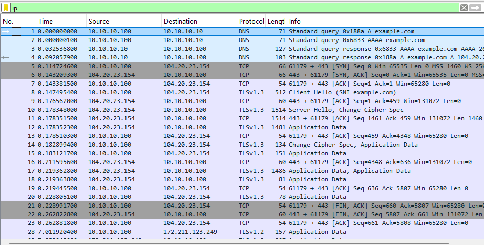
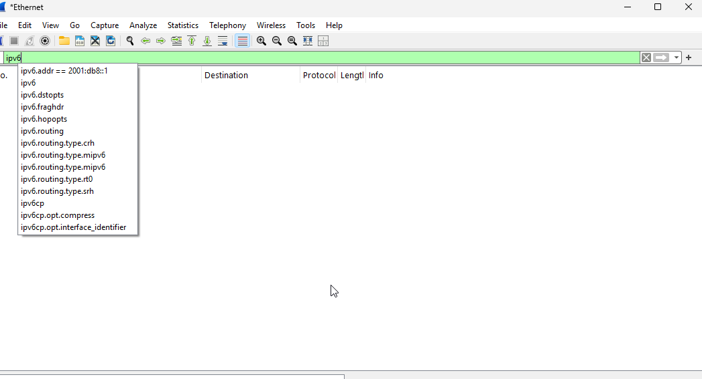

# Evidence 03 - IPv4 and IPv6 Packet Analysis

> The screenshots contain purpose-built private lab addresses and public service addresses only. No credentials, full hardware addresses, or subscriber public address are shown.

## IPv4 Display Filter

Wireshark filter:

~~~text
ip
~~~

Observed sequence:

~~~text
10.10.10.100 -> 10.10.10.10       DNS A query for example.com
10.10.10.100 -> 10.10.10.10       DNS AAAA query for example.com
10.10.10.10  -> 10.10.10.100      DNS responses

10.10.10.100:<EPHEMERAL> -> 104.20.23.154:443  SYN
104.20.23.154:443 -> 10.10.10.100:<EPHEMERAL>  SYN, ACK
10.10.10.100:<EPHEMERAL> -> 104.20.23.154:443  ACK

TLS 1.3 Client Hello, SNI=example.com
TLS 1.3 Server Hello and encrypted Application Data
TCP FIN, ACK connection close
~~~

Key observations:

- the TCP three-way handshake completed successfully;
- HTTPS used destination port 443 and an ephemeral client port;
- TLS protected the application content;
- SNI still exposed the requested host name in this capture;
- both `A` and `AAAA` DNS questions were transported over IPv4.

## IPv6 Display Filter

Wireshark filter:

~~~text
ipv6
~~~

Result: no matching packets in the captured sample.

## ICMPv6 Control Filter

Wireshark filter:

~~~text
icmpv6
~~~

Result: no matching packets. No neighbor discovery, router advertisement, or other ICMPv6 control messages appeared during this capture window.

## Conclusion

PC01 had an active IPv6 stack and a link-local address, but the observed web session used IPv4. The absence of an IPv6 default route and the empty `ipv6` and `icmpv6` filters are consistent with a link-local-only IPv6 configuration.
