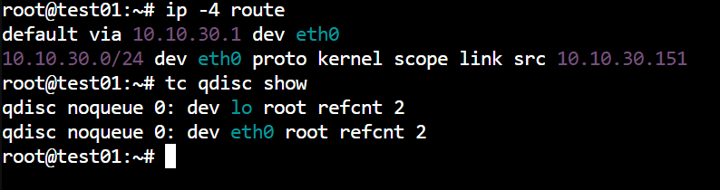
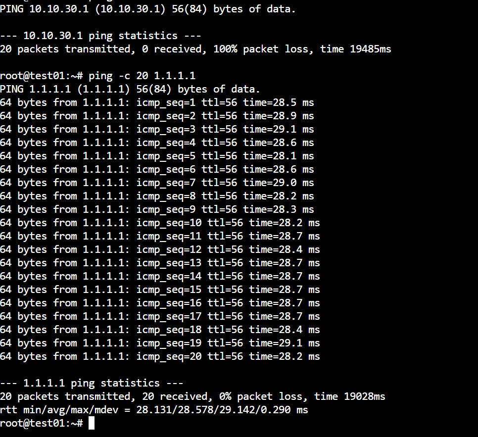
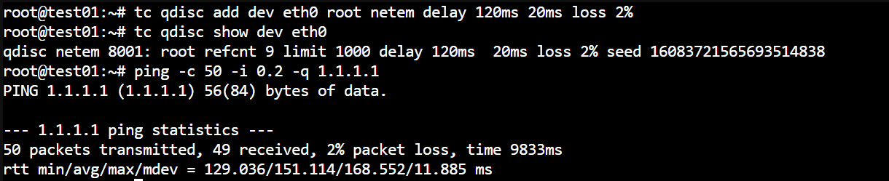
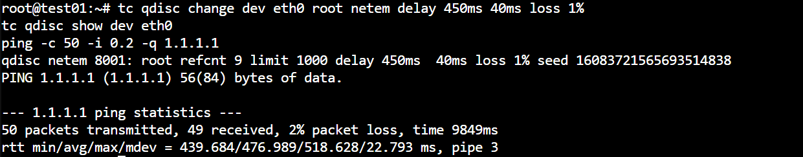
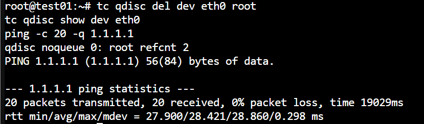
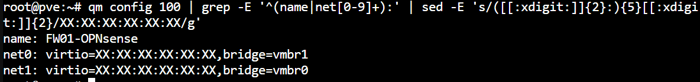
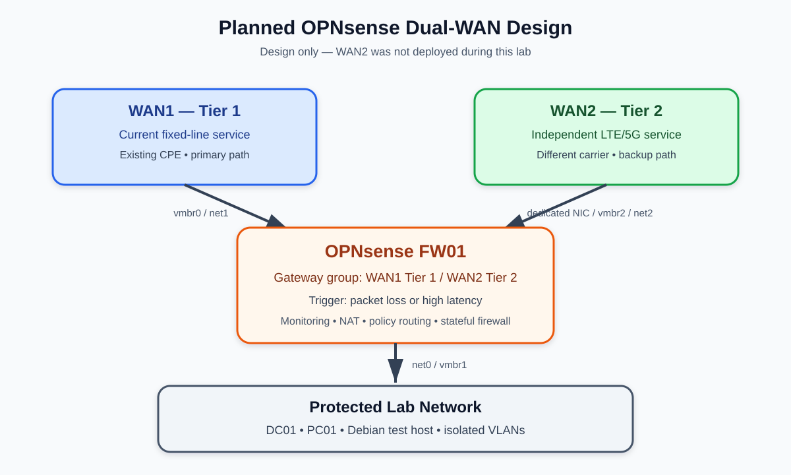

# WAN Quality, Impairment, and Resilience

This module documents baseline WAN measurements, controlled latency, jitter, and packet-loss emulation with Linux `tc netem`, complete restoration of the original queueing state, and a safe design for future OPNsense dual-WAN failover.

Earlier modules already document interface inventory, routing, packet capture, and NAT. This module adds only the new WAN-quality and resilience work rather than repeating those exercises.

## Objectives

The exercises were designed to:

- establish a repeatable latency and packet-loss baseline;
- distinguish firewall filtering of the gateway itself from forwarded Internet connectivity;
- emulate two degraded WAN profiles with controlled delay, jitter, and random loss;
- measure the effect of each profile and explain sampling limitations;
- remove the impairment and verify that the original network behavior returned;
- map the current OPNsense WAN and LAN attachment points without changing them;
- design an independent LTE/5G backup WAN, gateway group, test plan, and rollback procedure.

## Environment

| Component | Role | Relevant detail |
|---|---|---|
| test01 | Debian test host | `eth0`, private lab subnet, OPNsense as the default gateway |
| OPNsense FW01 | Firewall, router, and NAT gateway | Current WAN on `net1/vtnet1`, protected LAN on `net0/vtnet0` |
| Proxmox VE | Hypervisor and virtual switching | Current WAN through `vmbr0`, protected LAN through `vmbr1` |
| WAN1 | Current fixed-line service | Primary path in the resilience design |
| WAN2 | Planned LTE/5G service | Independent backup path; not deployed during this exercise |

No second WAN was connected and no production firewall, routing, NAT, or gateway-group setting was changed.

## Lab 1 - Baseline Connectivity

The initial route and queueing state were checked with:

~~~bash
ip -4 route
tc qdisc show
~~~

The default IPv4 route pointed to the OPNsense gateway through `eth0`. Both `lo` and `eth0` used `noqueue`, confirming that no traffic-control impairment was active.

Two ICMP tests produced different but compatible results:

- the OPNsense interface address did not answer ICMP because the firewall policy blocked traffic to the gateway itself;
- the same host successfully reached the external test target with 0% loss and an average RTT of 28.578 ms.

This distinction is important: filtering traffic addressed to a firewall does not prove that routed traffic through the firewall is unavailable.

## Lab 2 - Controlled WAN Impairment with netem

### Profile A - Moderate Delay, Jitter, and Loss

~~~bash
tc qdisc add dev eth0 root netem delay 120ms 20ms loss 2%
tc qdisc show dev eth0
ping -c 50 -i 0.2 -q 1.1.1.1
~~~

The average RTT increased to 151.114 ms, jitter increased to 11.885 ms, and one of 50 probes was lost.

### Profile B - High-Latency Access Link

~~~bash
tc qdisc change dev eth0 root netem delay 450ms 40ms loss 1%
tc qdisc show dev eth0
ping -c 50 -i 0.2 -q 1.1.1.1
~~~

The average RTT increased to 476.989 ms and jitter increased to 22.793 ms. One lost probe in a 50-packet sample is reported as 2%, even though the configured random loss probability was 1%.

### Cleanup and Restoration

~~~bash
tc qdisc del dev eth0 root
tc qdisc show dev eth0
ping -c 20 -q 1.1.1.1
~~~

The root qdisc returned to `noqueue`. Average RTT returned to 28.421 ms with 0% loss, closely matching the original baseline.

The full measurement comparison and limitations are documented in [findings.md](findings.md).

## Lab 3 - Dual-WAN Resilience Design

A read-only Proxmox inventory confirmed the current attachment points:

| OPNsense adapter | Proxmox bridge | Function |
|---|---|---|
| `net0/vtnet0` | `vmbr1` | Protected LAN |
| `net1/vtnet1` | `vmbr0` | Current WAN1 |
| `net2/vtnet2` | Not present | Planned WAN2 |

The published inventory masks the virtual hardware addresses.

The proposed WAN2 path is:

~~~text
Independent LTE/5G CPE -> dedicated host NIC -> vmbr2 -> OPNsense net2/WAN2
~~~

The gateway-group policy would use:

- WAN1 as **Tier 1**;
- WAN2 as **Tier 2**;
- **Packet Loss or High Latency** as the failover trigger;
- independent external monitoring and service-level DNS/HTTPS checks;
- outbound NAT and policy routing that are valid on both paths.

The second link should use a different carrier and access medium, a separate CPE, and independent power where practical. Reusing the same provider, upstream CPE, physical path, or power source would leave common failure points.

The design, impact analysis, validation plan, and rollback procedure are documented in [dual-wan-design.md](dual-wan-design.md).

## Measurement Results

| State | Configured impairment | Average RTT | RTT variation (mdev) | Observed loss |
|---|---|---:|---:|---:|
| Baseline | None | 28.578 ms | 0.290 ms | 0% |
| Profile A | 120 ms ± 20 ms, 2% loss | 151.114 ms | 11.885 ms | 2% |
| Profile B | 450 ms ± 40 ms, 1% loss | 476.989 ms | 22.793 ms | 2% |
| Restored | None | 28.421 ms | 0.298 ms | 0% |

Because `netem` was attached to the egress root qdisc of `eth0`, only the outgoing echo request was impaired. The measured RTT therefore increased by approximately the configured delay rather than twice that value.

## Validation Summary

| Requirement | Status |
|---|---|
| IPv4 route and original qdisc state verified | PASS |
| Baseline RTT and packet loss measured | PASS |
| Gateway filtering distinguished from forwarded connectivity | PASS |
| Moderate impairment profile applied and measured | PASS |
| High-latency impairment profile applied and measured | PASS |
| netem removed and original behavior restored | PASS |
| Current OPNsense WAN/LAN bridge mapping documented | PASS |
| Dual-WAN architecture, impacts, test plan, and rollback designed | PASS |
| Physical WAN2 connection and live failover test | NOT DEPLOYED - FUTURE LAB |

## What I Learned

- Link availability, latency, jitter, and packet loss are separate properties and must be measured independently.
- A firewall can reject traffic addressed to itself while continuing to route permitted traffic.
- Linux `tc netem` can reproduce degraded access-link behavior without changing the router or upstream connection.
- Short packet-loss tests have coarse statistical resolution; one loss in 50 probes equals 2%.
- Queueing changes must be removed and the baseline re-measured after testing.
- Resilience requires independent failure domains, not merely two logical interfaces.
- Failover can restore new outbound connections, but existing NAT states, VPN sessions, and long-lived flows may reset when the egress address changes.
- A documented rollback is part of the design, not an afterthought.

## Security and Privacy

The screenshots and transcripts were reviewed before publication. Full MAC addresses, credentials, subscriber public addresses, ISP account data, exact location information, and personal identifiers are not included. Private RFC 1918 lab addresses, purpose-built host names, interface names, and the public test resolver address remain only where required to explain the exercise.

## Conclusion

The exercises demonstrated a complete WAN-quality workflow: establish a baseline, introduce controlled impairment, measure its effect, remove the impairment, verify recovery, and design a resilient secondary path without changing the working firewall. The live dual-WAN deployment is intentionally reserved for a separate maintenance-window lab.

[Back to the main portfolio](../../)
